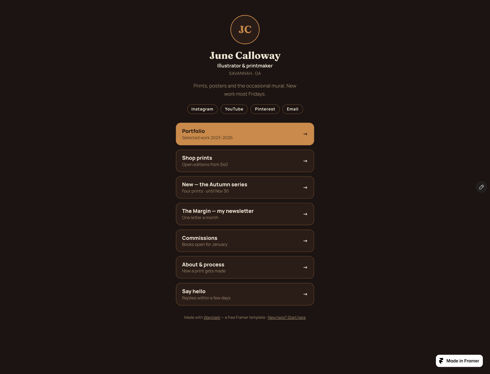
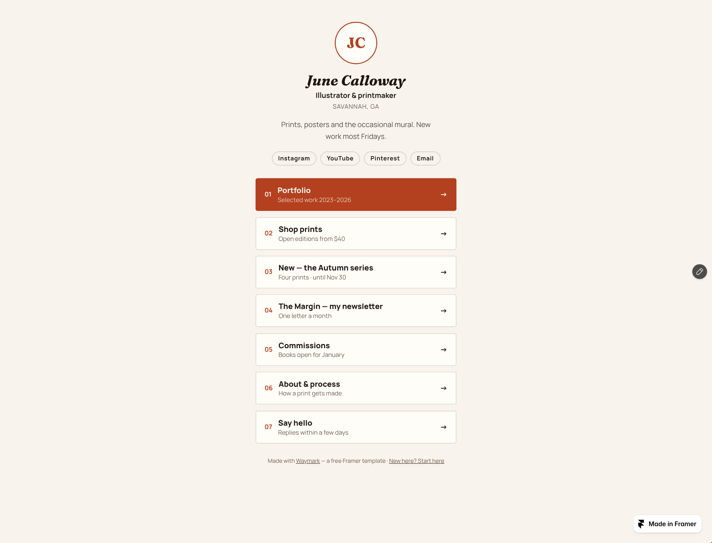
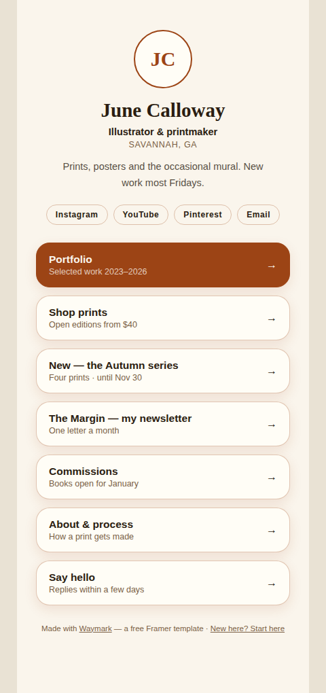
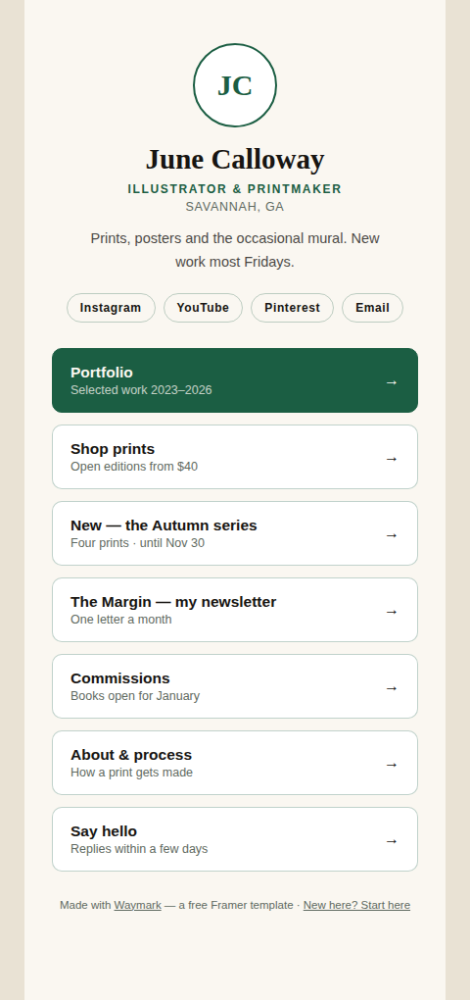
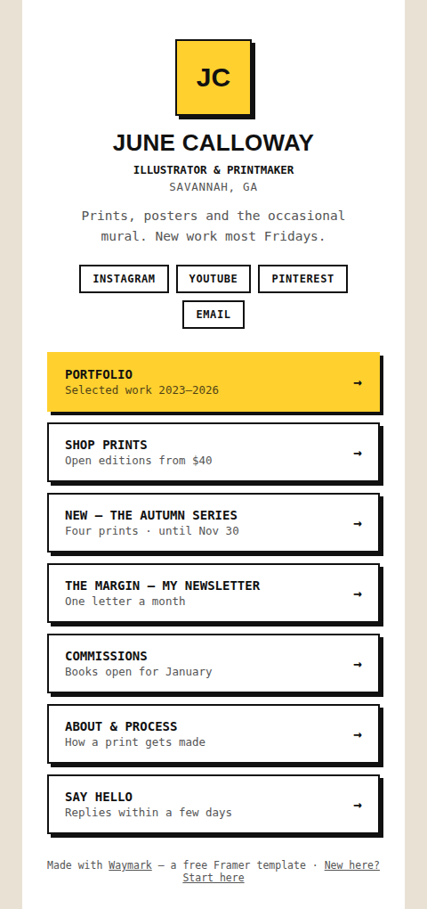
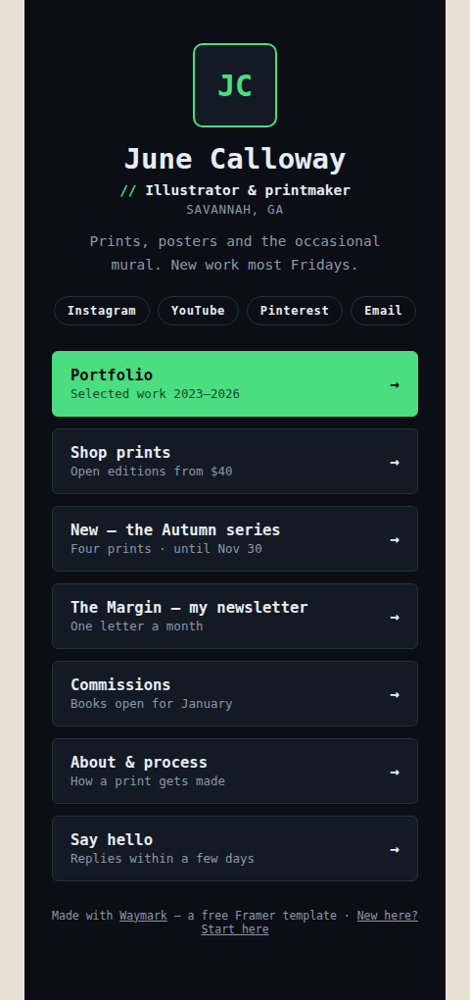
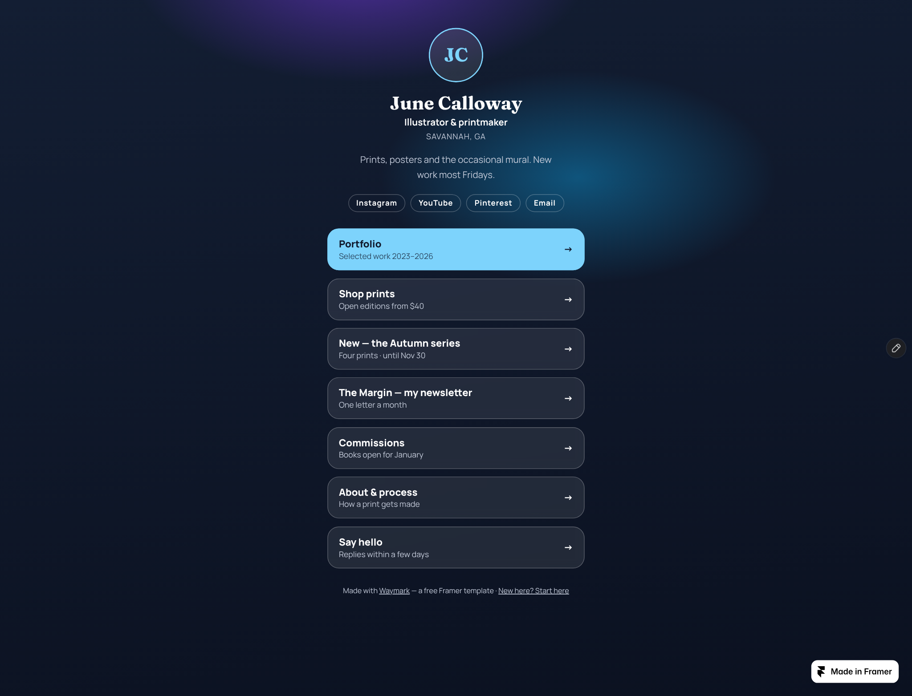
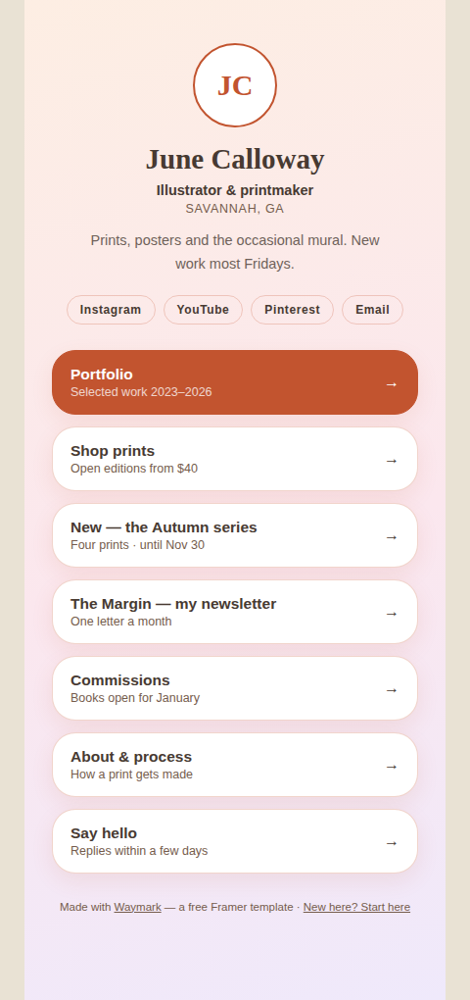
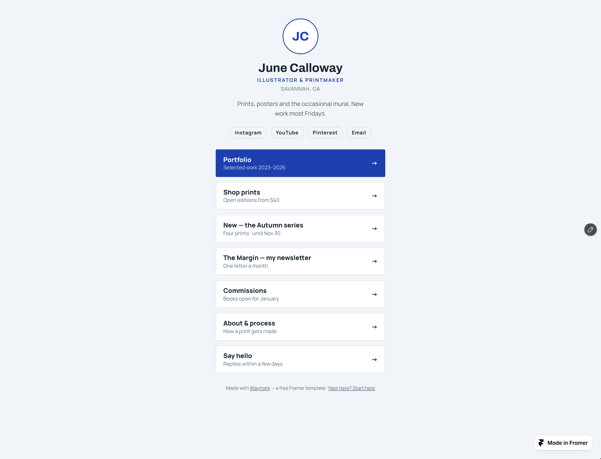
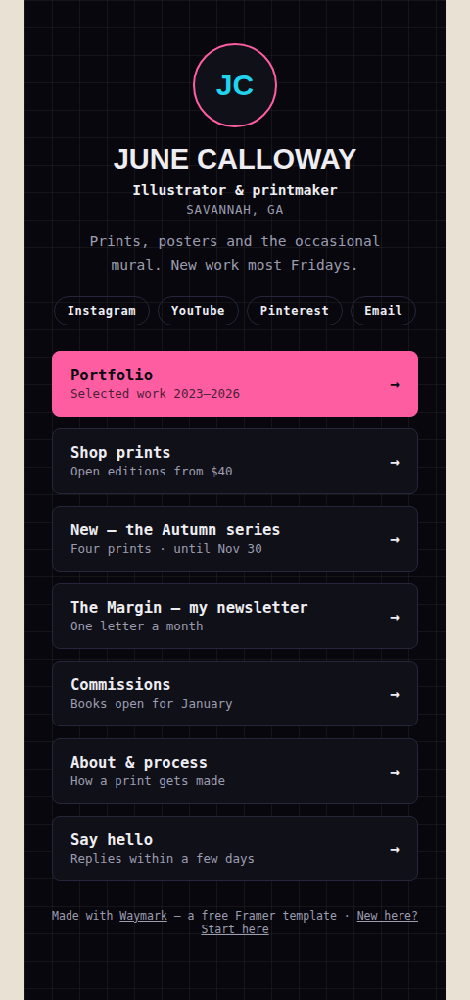

# Waymark — a free Framer link-in-bio template with ten switchable styles

**Status: built in Framer (2026-11-21); publish + listing are the
remaining steps.** The project was built from `FRAMER_BUILD_SPEC.md`
in a fresh Framer project, **Waymark — Link in Bio**
(https://framer.com/projects/ilbNe2m8lZoHDjilIuyB), and each page was
checked against the screenshots in `marketplace/` and the
`preview/` mock. This repo is the full template package — build
spec, the switching guide that ships inside the template, CMS
content, listing copy and submission checklist. What was built, and
where it differs from the spec, is in DECISION_LOG D7.

Waymark is the Framer edition of
[astro-link-in-bio-theme](https://github.com/ctrimm/astro-link-in-bio-theme)
(19★), re-cast as a sampler of this catalog's design languages.

## Screenshots

The preview's style switcher — the same mechanism the template
teaches (content lives in the CMS once; styles are pages/variants
reading from it):






















## The idea

Most link-in-bio templates make you pick a look before you've seen
your own page in it. Waymark keeps the profile and links in the
CMS — one place — and ships ten style pages that all read from
it. Fill in your links once, preview your page in all ten looks,
set the winner as home, publish. Switching later takes a minute
because the content never moves.

| Style | Look | Free taste of |
|---|---|---|
| **Nocturne** | espresso + copper, dark editorial | Nocturne (supper-club sites, $59) |
| **Vermilion** | paper + vermilion, numbered links | Vermilion Folio (editorial portfolios) |
| **Crumb** | cream + burnt crust, warm pills | Crumb Culture (bakery/café) |
| **Ledger** | paper + ledger green, small caps | Wagesmith (payroll/SaaS, $79) |
| **Brutalist** | black/white + signal yellow, hard shadows | the original Astro theme's signature look |
| **Dev** | terminal black + green, all mono | the original Astro theme, riffed |
| **Glassy** | frosted glass over a night-sky gradient | the original Astro theme, riffed |
| **Pastel** | watercolor wash, soft white cards | the original Astro theme, riffed |
| **Resume** | slate + professional blue, hairline rows | the original Astro theme, riffed |
| **Retro** | black grid, neon cyan + pink | the original Astro theme, riffed |

## Switching, three ways (the guide in one paragraph)

1. **Pick a page** — preview all ten with your content, set one
   as home. Zero skill required.
2. **Flip a variant** — Profile Card, Link Button and Socials Row
   each carry all ten styles as a variant property; re-skin a
   page in place.
3. **Edit the styles** — every token exists as a named Color/Text
   Style per look; change the style, change the look.

The full buyer-facing version is `SWITCHING_GUIDE.md` — it ships
inside the template as the "Start here" page.

## Package contents

```
FRAMER_BUILD_SPEC.md      Pages, components, variants, tokens (all contrast-verified)
SWITCHING_GUIDE.md        The buyer guide / in-template Start here page
MARKETPLACE_LISTING.md    Paste-ready free listing (price: FREE)
SUBMISSION_CHECKLIST.md   Build → quality → publish → list → aftercare
DECISION_LOG.md           Why Waymark, why five styles, why CMS-first
cms/                      SCHEMA.md + import-ready Profile and Links CSVs
preview/                  Interactive style-switcher preview (open index.html)
marketplace/              Listing screenshots from the verified preview
SOURCES.md                Framer's official template guidance, retrieved 2026-11-16
```

## Why free?

Waymark's job is discovery: Framer signups through the remix link
(creators earn 50% of a referred subscription's first year) and a
working sample of the paid catalog's four design languages in
every download. It's provided as-is, without support — the Start
here page is the manual.

## License

Template design and package © Cory Trimm. Demo content (June
Calloway) is fictional.
